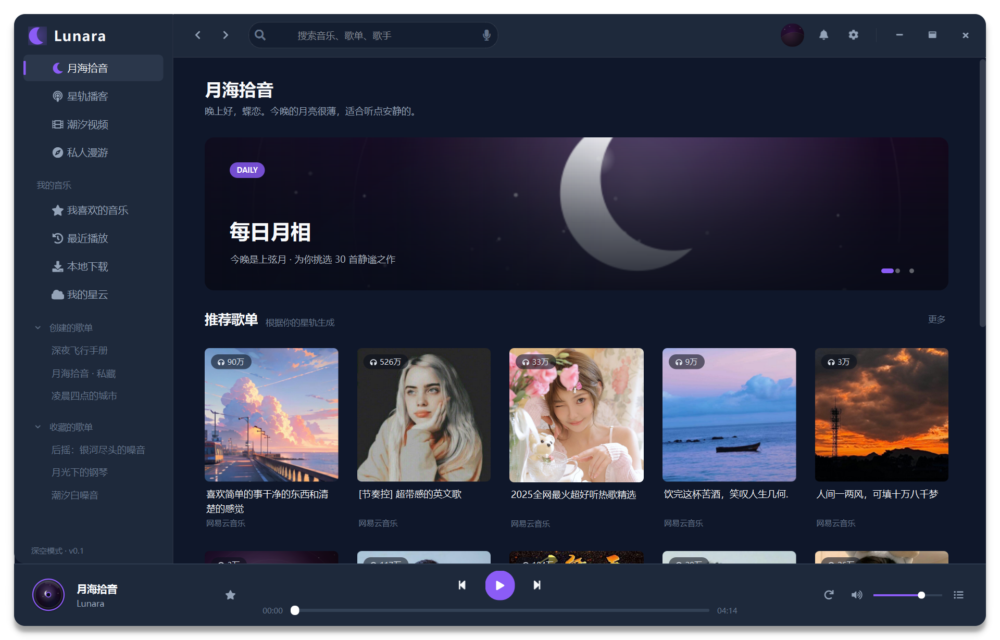
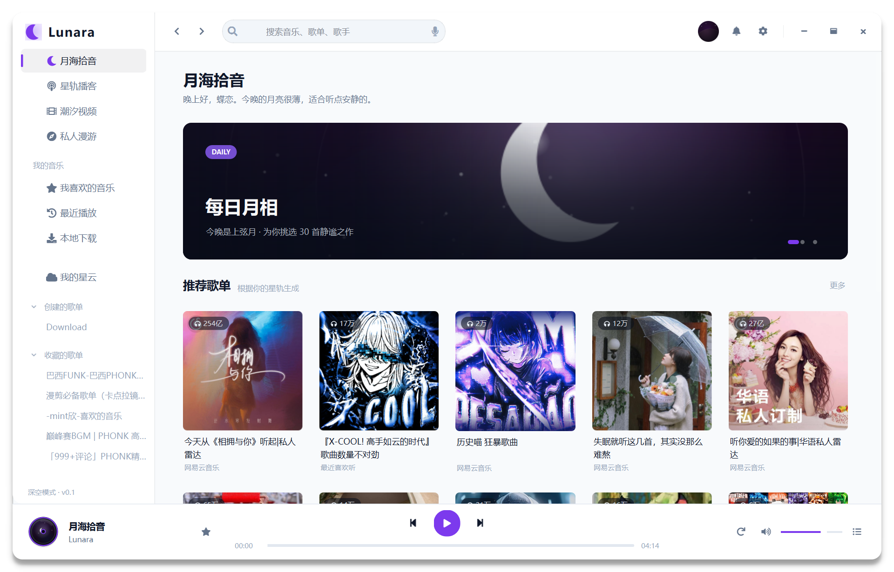
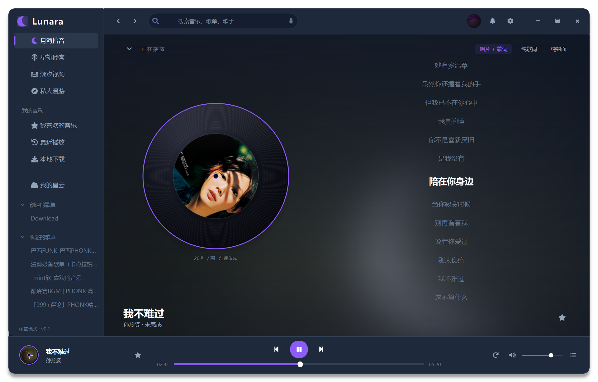
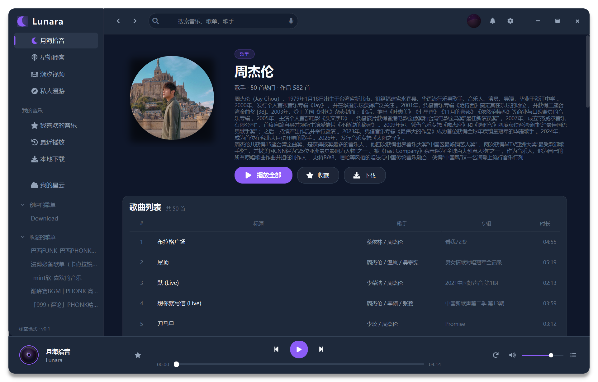
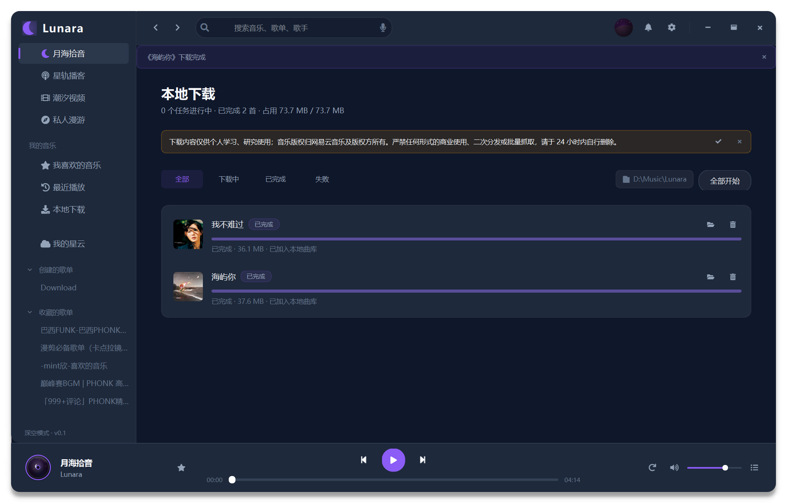
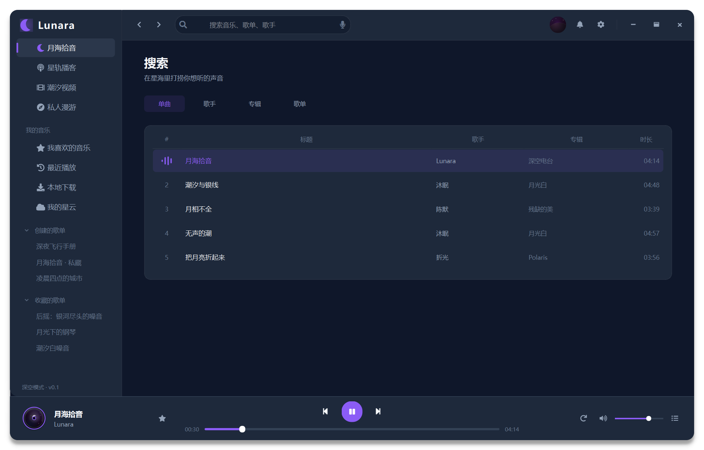
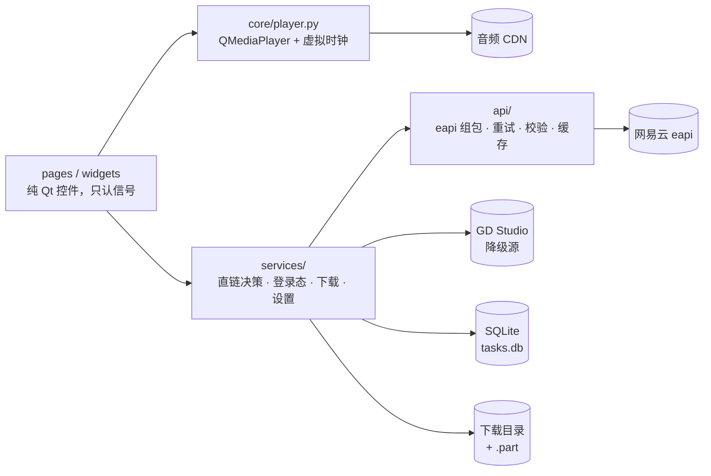

<div align="center">


<h1>Lunara</h1>

<p><b>把网易云音乐装进一个深空风格的桌面壳子</b></p>

<p>真实播放 · 真实下载 · 账号登录 · 歌手 / 专辑页 · 深浅双主题</p>

<p>


</p>

</div>

---

> [!IMPORTANT]
> **本项目仅供个人学习与研究。**
> 它不附带任何音乐内容，所有数据与音频都来自网易云音乐官方接口；代码里没有任何绕过付费的逻辑。
> 严禁将本工具用于商业用途、二次分发或批量抓取。下载得到的文件请在 24 小时内自行删除。
> 首次进入下载页会提示一次，同一段声明也会写进下载目录的 `NOTICE.txt`。

> [!WARNING]
> 需要登录的接口使用**你自己的账号 Cookie**，只保存在本机
> （`%APPDATA%/Lunara/session.enc`，Windows DPAPI 加密），退出登录即删除。
> 使用非官方客户端可能带来的账号风险，由使用者自行承担。

---

## 特性

| 模块 | 说明 |
|---|---|
| **无边框窗口** | 悬浮阴影、`startSystemMove` 拖动、双击最大化、右下角缩放，最小 1056×752 |
| **侧边栏** | 弯月 Logo、主导航、我的音乐、可折叠歌单组、3px 主色指示条 |
| **首页** | Banner 淡入淡出轮播、5 列推荐歌单网格（播放量胶囊 / 两行截断标题） |
| **歌单 / 歌手 / 专辑** | 同一套骨架复用：180px 封面、播放全部、QTableView 歌曲表；歌手用圆形头像 + 50 首热门 |
| **播放页** | 唱片+歌词 / 纯歌词 / 纯封面（星光粒子）三种模式，高斯模糊背景 |
| **真实播放** | `QMediaPlayer` + 直链解析（官方 → GD Studio 降级），进度 / 时长 / seek 全走真实音频 |
| **搜索** | 单曲 / 歌手 / 专辑 / 歌单四类，四类都能点进详情，单曲支持「加载更多」分页 |
| **喜欢** | 星标同步到账号（`/api/song/like`），失败自动回滚并提示 |
| **下载** | 流式下载 + `Range` 断点续传 + SQLite 任务表；暂停、退出、断网都能续，重启自动恢复 |
| **本地播放** | 下载完成的文件可直接播，不联网、不走直链 |
| **主题** | 深空 / 月光白两套，设置里切换（重启生效） |
| **播客** | 推荐单集来自网易云电台，点开直接播 |
| **私人漫游** | 随机挑一张推荐歌单洗牌，一次 50 首，每次都不一样 |
| **最近播放** | 本地记录最近 100 首，关掉应用也在 |
| **本地曲库** | 扫描下载目录、读标签，本地文件直接播 |
| **记忆播放位置** | 下次听同一首，从上次停下的地方继续 |

## 界面

| 深空主题 | 月光白主题 |
|---|---|
|  |  |

| 播放页 | 歌手页 |
|---|---|
|  |  |

| 下载 | 搜索 |
|---|---|
|  |  |

## 快速开始

```bash
git clone https://github.com/Ayanokoji-Lin/Lunara.git
cd Lunara

python -m venv .venv
.venv/Scripts/activate
pip install -r requirements.txt

python main.py
```

桌面上还有一个 `Lunara.bat`（用系统 Python，缺库会自动装），双击即可启动。

登录功能需要 `PyQt6-WebEngine`（已写进 `requirements.txt`）；没装时应用照常运行，
只是「登录」会退化成一句安装提示。若登录窗口一片空白，多半是显卡上下文问题，
用 `QT_OPENGL=software` 启动一次即可。

## 架构总览



请求层全异步，UI 不接触加密密钥、也不直接拼请求。页面之间不互相引用，
导航统一走 `MainWindow.navigate(key)`；`Player` 对外只有 6 个信号 + 8 个方法，
换内核时界面一行都不用改。

直链按「官方 → GD Studio」降级：官方只给 45 秒试听（或干脆不给）时，
自动转 GD 取完整文件，并把实际码率如实标成档位。

| 环境变量 | 默认 | 作用 |
|---|---|---|
| `LUNARA_GDSTUDIO_BASE` | `https://music-api.gdstudio.xyz/api.php` | 换 GD 地址 |
| `LUNARA_GDSTUDIO_DISABLED` | 空 | 置 `1` 关掉降级源 |
| `LUNARA_MUSIC_U` | 空 | 注入登录 Cookie |

```python
# 业务侧（协程）
from lunara.api import ApiClient
from lunara.api.modules.search import search_songs
from lunara.services.player_url import PlayerUrlService, QualityLevel

async with ApiClient() as client:
    result = await search_songs(client, "周杰伦", limit=30)
    outcome = await PlayerUrlService(client).resolve(347230, QualityLevel.LOSSLESS)
```

Qt 里不要自己 `await`，用桥接把协程丢到后台循环，回调回主线程：

```python
from lunara.services.qt_bridge import QtAsyncBridge

self._bridge = QtAsyncBridge(self)
self._bridge.submit(search_songs(client, text),
                    on_success=self._show_results,
                    on_error=self._show_error)
```

## 使用说明

**播放**：点播放先解析直链，再交给 `QMediaPlayer`。解析是异步的，切歌后迟到的结果会被丢弃
（内部用单调递增的 `seq` 判断），所以连续快速切歌不会串台。进度条与歌词都用**真实时长**，
和接口给的 `duration` 差几秒属于正常。

**下载**：任务表在 `%APPDATA%/Lunara/tasks.db`，文件落到设置里的下载目录
（默认 `D:\Music\Lunara`）。暂停、退出应用、断网都会保留 `.part`，恢复后从断点继续；
删除任务只删任务与 `.part`，已经下完的文件不会被动。设置 → 下载可以改目录与并发数。

**主题**：设置 → 播放 → 外观主题。切换会写进 `%APPDATA%/Lunara/settings.json`，
**重启应用后生效**——页面里不少颜色是在构造时写进内联样式的，运行时热切换会留下旧色。
轮播图与封面属于「画作」，不跟随主题：底图始终是深色，标题固定用浅色。

### 快捷键

| 按键 | 功能 |
|---|---|
| `Space` | 播放 / 暂停（输入框内不生效） |
| `Ctrl + ← / →` | 上一首 / 下一首 |
| `Ctrl + ↑ / ↓` | 音量 ±5 |
| `Esc` | 返回上一页 |

## 开发与测试

```bash
.venv/Scripts/python.exe -m pytest                                   # 257 项，全打桩不联网
LUNARA_LIVE=1 .venv/Scripts/python.exe -m pytest tests/test_live.py  # 真上游冒烟

.venv/Scripts/python.exe tools/verify_ui_live.py        # 首页 / 歌单端到端 + 截图
.venv/Scripts/python.exe tools/verify_artist_album.py   # 歌手页 / 专辑页
.venv/Scripts/python.exe tools/verify_download.py       # 真实下载（会写文件）
.venv/Scripts/python.exe tools/verify_playback.py       # 真实播放（会出声）
.venv/Scripts/python.exe tools/verify_error_bar.py      # 错误提示条 + 一次播放只解析一次
.venv/Scripts/python.exe tools/make_icon.py             # 重新生成图标
```

测试全部用 `httpx.MockTransport` 打桩，`tests/fixtures/` 存真实回包——
上游字段漂移时，单测会先红，不用等界面报错。

## 目录结构

```
Lunara/
├─ main.py                  入口：QSS、字体、窗口
├─ lunara/
│  ├─ theme.py              设计令牌 + QSS 模板（$var 注入）
│  ├─ data.py               演示数据与数据类型（Track / Playlist / DownloadTask）
│  ├─ core/player.py        播放内核：QMediaPlayer / 虚拟时钟双引擎
│  ├─ api/                  eapi 客户端、模型、模块、错误码
│  ├─ services/             直链决策、登录态、下载、设置、模型适配、异步桥
│  ├─ pages/                首页 / 歌单 / 搜索 / 播放 / 下载 / 设置
│  └─ widgets/              侧栏、播放栏、封面、进度条、提示条…
├─ assets/icon.ico          应用图标（16–256 共 7 档）
├─ tools/                   验收脚本与打包脚本
├─ tests/                   257 项单测 + 真实回包夹具
└─ docs/                    API 事实、架构、接线计划
```

## 打包

```bash
.venv/Scripts/python.exe tools/build.py      # PyInstaller onedir
dist/Lunara/Lunara.exe
```

产物在 `dist/Lunara/`（约 478 MB，已把 WebEngine 调试资源与多余翻译挪出包外），不入库。
重新打包会把旧目录改名挪到 `dist/.old/`——删上千个文件太慢，也容易被打断。
想更小可以手动排除未用的 Qt 模块，或者去掉内嵌登录。

## 已知缺口

- **收藏歌单**：`/api/playlist/subscribe` 在 eapi 下恒返回 405「操作过于频繁」，暂不可用。
- **已喜欢的歌**：启动时不拉「我喜欢的音乐」的 id 列表，所以已喜欢的歌初始是未点亮状态；
  再点一次是幂等的（服务端按 `like=true` 再确认）。
- **本地曲库扫描**：现在只能播「下载页里已完成的文件」，还没有扫描任意目录、读标签（`mutagen`）。

## 声明

本项目与网易云音乐官方无关，仅用于个人学习 Qt 与桌面端工程实践。
所有音乐版权归网易云音乐及版权方所有，请支持正版。
若权利人认为本项目存在侵权，请通过 issue 联系，我会立即处理。

文档：数据层事实见 [`docs/API-PLAN.md`](docs/API-PLAN.md)，
架构与工程约定见 [`docs/ARCHITECTURE.md`](docs/ARCHITECTURE.md)，
接线进度见 [`docs/UI-INTEGRATION-PLAN.md`](docs/UI-INTEGRATION-PLAN.md)，
剩余功能记录见 [`docs/PLAN-REMAINING.md`](docs/PLAN-REMAINING.md)。
